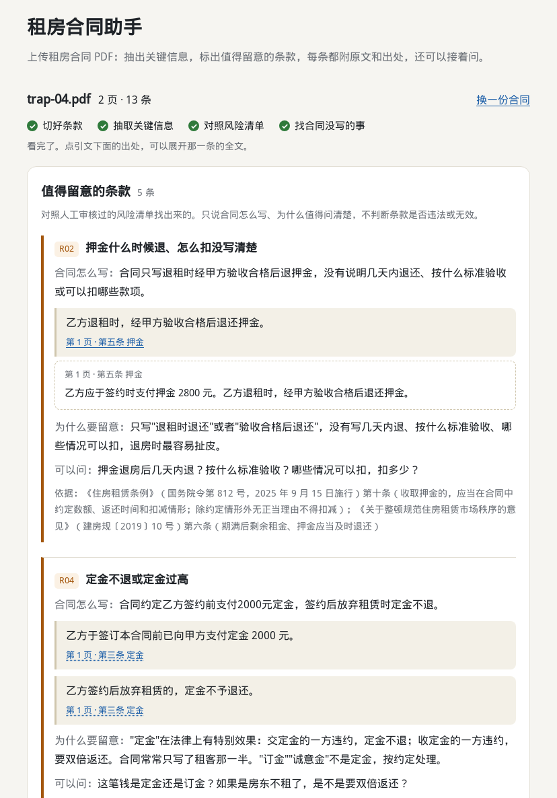

# 租房合同助手（开发中）

上传一份租房合同 PDF：抽出关键信息（租金、押金、租期、违约金……抽不到就空着，不编），标出对租客不利、容易被忽略的条款，每条都附原文和出处（第几页、第几条），还可以接着追问。

它不是法律意见：只提醒哪里值得留意、建议问清楚，不下"这条违法"之类的结论。



## 运行

需要 [uv](https://docs.astral.sh/uv/)（它会自己装好 Python 3.12 和依赖）。

```bash
uv sync
cp .env.example .env    # 填上模型接口（OpenAI 兼容）
uv run contract-agent   # 启动在 http://127.0.0.1:8300
```

试一下：

```bash
# 流式回答
curl -N -X POST http://127.0.0.1:8300/ask -H 'Content-Type: application/json' -d '{"question":"签租房合同前最该看清楚什么？"}'
# 上传合同 PDF，按条款切好
curl -X POST http://127.0.0.1:8300/contracts/parse -F file=@samples/zufang-01.pdf
# 命令行里看切分结果
uv run python -m contract_agent.clauses samples/zufang-01.pdf
# 就合同追问（流式，带出处）
curl -N -X POST http://127.0.0.1:8300/contracts/ask -F file=@samples/zufang-03.pdf -F question=退房后押金多久退
# 测试（不调用模型）
uv run pytest
# 追问评测：检索召回率；加 --answer 再比较检索和全文的回答
uv run python evals/qa.py
# 埋坑评测：默认开发组、每份 3 次；--set test 跑测试组，--key 只检查答案表、生成给人审的版本
uv run python evals/traps.py --runs 5
# 后台任务实测：排队、同一份再传、清单改一个字、跑到一半重启（真的调模型）
uv run python evals/jobs.py
# 页面验收：先启动服务，再用无头 Chrome 走一遍并截图（字体环境同 scripts/make_samples.py）
uv run python scripts/check_page.py samples/trap-02.pdf 押金多久退
```

上传页面：启动后浏览器打开 http://127.0.0.1:8300/ 。

后台任务（页面用这一组）：

```bash
# 上传，马上返回任务号和切好的条款（202：收下了，还没做完）
curl -X POST http://127.0.0.1:8300/jobs -F file=@samples/zufang-01.pdf
# 看进度：先补发已经做完的步骤，之后做完一步推一步
curl -N http://127.0.0.1:8300/jobs/任务号/events
# 就这份合同追问，不用再传 PDF
curl -N -X POST http://127.0.0.1:8300/jobs/任务号/ask -H 'Content-Type: application/json' -d '{"question":"押金多久退"}'
```

## 读 PDF、切条款

`samples/` 里是两份虚构的租房合同（`samples/src/` 是源文件，`scripts/make_samples.py` 用无头 Chrome 生成 PDF，每页带页眉页脚）：一份用"第一条"做标题、有表格、3 页；一份用"一、"做标题、"（一）"分项、2 页。

- **按条款切，不按字数切**：识别"第三条""三、"这样的标题；编号必须一条接一条，正文里以"第三条约定的……"开头的一行不会被当成标题。标题之前是开头（合同名、双方），签字栏单独一块。
- **页眉页脚**：只看每页最上、最下一行，在大多数页上都出现的就去掉（数字换成 # 再比，"第 1 页""第 2 页"算同一个）。第 1 页的页眉和合同标题常常一模一样，所以每页只去一行。
- **折行**：PDF 把一句话折成几行。只看标点会把开头那几行短行（"出租方：周某某"）接成一句；改成看这一行有没有写到右边缘：写满了、又没在句末标点处结束，才和下一行接上。"1.""（一）"开头的分项、表格行、签字栏不接。
- **表格**：单独识别，整理成 `| 物业管理费 | 甲方 | — |` 这样的行，按位置插回原处，不和前后文字混在一起。
- **出处**：每块记下来自哪几页，一条被分页截断时是 `[2, 3]`。
- 扫描件、照片读不出文字，明确报错，第一版不支持。

## 抽取关键信息

`POST /contracts/extract`（命令行：`uv run python -m contract_agent.extract samples/zufang-01.pdf`）抽出 14 项：出租方、承租方、地址、租期、月租金、付款方式、押金、押金退还、逾期付租、涨租、提前解约、维修、转租、各项费用。

- **格式由接口约束**：`ContractInfo` 是一个 Pydantic 类，生成 JSON Schema 交给接口，模型严格按格式输出（结构化输出）。返回后再用 Pydantic 逐项校验，哪一项不合格只扔那一项。
- **内容由代码核对**：每一项都要附合同原文，内容写在几处就附几句，表格附整行。代码检查每一句都真的在合同里（去掉空白再比）；出处写错了块，按原文找到并改正；金额必须作为完整的数出现在原文里（320 不算 3200），日期必须以常见写法出现。有一句对不上，整项扔掉，并写明原因。
- **没写就留空**：第二份样本合同没写逾期付租和转租，抽出来就是空的，不按常识补。
- **还没覆盖到的**：只核对附的原文确实存在，不核对概括有没有超出原文说的（留给评测时让裁判判）；金额只认阿拉伯数字，只写大写金额的会被扔掉，宁可留空。

## 风险条款

`POST /contracts/review`（命令行：`uv run python -m contract_agent.risks samples/zufang-02.pdf`）在关键信息之外，再列出值得留意的条款和合同里没写的事。

- **清单人工审核**：`knowledge/风险清单.md` 列了 26 种常见的坑（押金不退、租期内涨租、维修全推给租客、房东随时收房……），每条写了典型写法、为什么要留意、可以问房东什么、什么情况不算、依据和核对状态（通过 / 部分 / 待补）。读清单时从严：有"待核"、编号重复、对应字段不存在，直接报错。
- **整份清单放进提示词**：合同二三十条、清单二十几条，都很小，一次全给模型，不做检索，不会漏查；清单在提示词的固定部分，还能命中缓存。
- **模型只负责找**：模型报编号、附原文、写一句"这份合同怎么写的"。代码核对编号在清单里、原文在合同里（和抽取同一套核对），对不上整条扔掉。"为什么要留意""可以问""依据"都用清单里审过的文字；核对时的说明不返回给用户，"部分"的依据注明仅供参考，"待补"的不显示依据。
- **"没写"由代码判断**：清单里标了"没写也提示"的 4 项（押金退还、费用、维修、提前解约），第 3 步抽出来是空的，就提示"合同里没写，建议问清楚"。抽取时因为核对没通过被扔掉的不算"没写"，那只是没抽成功。
- 抽关键信息和比对风险同时进行，比对一次 4～13 秒。

两份样本各跑 4 次（gpt-6-luna）：

| 样本 | 每次都找到 | 每次都漏 | 误报 |
|---|---|---|---|
| 1 | R06 逾期每天 1% | R01 擅自转租押金不退 | R15 只写了租客的违约责任，4 次里 2 次（其实第九条第 1 款写了房东的） |
| 2 | R01、R02、R05、R13 | R24 附件清单没附上 | R15，4 次里 1 次 |

代码只能核对原文存在，核对不了"判断对不对"：R15 引用的原文是真的，结论却是错的。这类错误留给第 6 步的评测去量。

## 追问：检索还是全文

`POST /contracts/ask`（表单字段 `file`、`question`，可选 `mode=auto|full|retrieve`；命令行：`uv run python -m contract_agent.qa samples/zufang-03.pdf 我能养猫吗`）流式回答，说到合同的地方写成〔c46：原文片段〕。回答说完后代码逐个核对：片段在那一条里算通过；在别的条里就改正出处；哪条都没有就标成"未能核对"。这一句不删，因为回答是一整段话，删掉一句可能读不通。合同里找不到答案时，要以"合同里没写"开头，不按常识补。

- **向量检索**：一条条款一个向量，本地中文向量模型 `BAAI/bge-small-zh-v1.5`（约 90 MB，CPU，合同不出这台机器），向量存在 Qdrant 本地模式（`data/qdrant`，按合同内容的哈希分集合，同一份合同不重复计算）。
- **检索模式下说"没写"之前先改看全文**：可能只是没检索到。
- **长合同样本**：`samples/zufang-03.pdf`，84 条、分 10 章、带附件的长租公寓合同（12 页）。切分时"第二章 ……"记在每一条的 `chapter` 上，签字栏后的"附件一 ……"单独成块。

`evals/qa.py`，26 个问题（直白 8、换说法 14、合同里没写 4），gpt-6-luna：

| 检索方法 | 直白 前 6 | 换说法 前 1 | 换说法 前 6 |
|---|---|---|---|
| 关键词（两字片段） | 8/8 | 1/14 | 3/14 |
| 向量 | 8/8 | 9/14 | 12/14 |
| 关键词 + 向量融合 | 8/8 | 6/14 | 10/14 |

| 回答方式（跑两遍） | 答对 | 首字中位 | 总耗时中位 | 输入 token 中位 | 检索后又改看全文 |
|---|---|---|---|---|---|
| 检索前 6 条 | 25/26、26/26 | 1.7～1.8s | 3.7～4.0s | 约 890 | 6～7 题 |
| 全文 | 26/26、26/26 | 1.8～1.9s | 3.2～3.3s | 约 5400 | — |

- 融合比单用向量差：关键词对换了说法的问题几乎找不到，它的排名是噪音，把向量找对的挤了下去（心懂第一版混合检索也遇到过）。所以检索只用向量。
- **84 条的合同全文也只有约 5400 token，全文方式更准、更快**：检索本身只要 9 ms，但说"没写"的题要再看一遍全文。检索省下的是 token，每题约 6 倍。
- 检索答错的那题暴露了一个漏洞：模型在句中说"合同里也没有约定换房"，开头却没写"合同里没写"，于是没有改看全文。第 7 步修了：回答里不管哪里说到"没写""没有约定""没有说明"这类话，都改看全文再答。修完跑一次：检索方式 26/26，改看全文的题从 6～7 道变成 8 道，多花的是这一两道题的 token。
- 所以默认 `auto`：合同不超过 3 万字用全文，更长才检索。这个上限还没测过，只是在测过的最长合同（6550 字）上留了约 5 倍余量。等有更长的合同或要同时看几份合同时，再用评测定。

## 评测：埋了坑的合同

第 4 步只核对了引的原文是真的，没看模型能不能找出合同的坑。这一步量两件事：能不能找出合同的坑，合同没写的能不能提醒用户。

- **合同**：`samples/src/trap-01.md`～`trap-08.md` 是 8 份新写的虚构合同（个人房东、二房东隔断间、长租公寓、大体公道的一份……），加上第 4 步的两份样本，共 10 份。开发组 6 份（trap-01～04 和两份旧样本），测试组 4 份（trap-05～08）。每组都把清单里的 26 种坑各埋了至少一次，一共 60 个坑。
- **答案表** `evals/traps.json`，每份合同写明四样：
  - 坑：应该报，落在哪一条；
  - 诱饵：照着清单的"不要误报"写的，看起来像，其实不算，不应该报；
  - 两可：报不报都行；
  - 故意没写的事（押金怎么退、费用、维修、提前退租）：应该提示"合同里没写"。

  答案表由 AI 起草，人工审核：8 份新合同逐条审过、改了几处，两份旧样本按第 4 步定下的结论写。`--key` 生成带原文的 `evals/traps-答案.md`，方便对着审。
- **打分由代码做，不请模型当裁判**：编号对、引的原文落在答案表写的那一条，才算找到；编号对、条款不对，算位置不对；答案表里没有的编号都算误报，报到诱饵上的另外记。故意没写押金怎么退，模型引用押金那一条报了 R02，算提醒到了，不算误报：用户看到的是同一条提醒。
- **开发组用来调，测试组只跑一次**：所有改动都只看开发组的数。测试组等改完再跑一次，看改动是不是只在开发组上有效。
- **每份跑 5 次**：temperature 已经是 0，同一份合同每次的结果还是不一样。差两三个坑，分不清是改动的作用还是本来的波动。

提示词改了两处，清单改了一处，都只看开发组的数：

- **A：合同后面附了什么，由代码告诉模型。** 切分时已经知道签字栏后面有没有附件，就在合同最后加一句"签字栏后面附有……"或"没有附件"。模型自己分不清附件是没附上，还是没拿给它看：第二份旧样本写了"见附件清单"却没附，R24 以前 5 次全漏，加了这句以后 5 次全找到。同时把"合同没写的不报"改准确：完全没提到的不报（其中 4 项由代码提示），提到了、东西却没给的要报。
- **C：先对照"不要误报"，再决定报不报。** 每报一条，模型多写两项：拿"合同怎么写的"去对照清单的"不要误报"（`check`），再填算不算（`keep`）。不算的由代码去掉，原因记在结果里。先写对照、再下结论，模型常常会发现自己报错了：第一轮撤回 7 次，5 次撤得对，1 次撤错，1 次是两可。
- **R01 改字**：撤错的那一次，理由是"这是对特定违约情形约定押金不退，不是一律不退"，模型把标题里的"一律"读成了"所有情况都"。标题改成"押金整笔不退"，正文写明只针对一种情况也算。清单改动经人工同意。改完那一轮撤回 8 次，全部撤得对；第一份旧样本的 R01 5 次全找到。

| 开发组（6 份，每份 5 次） | 坑找到 | 误报 | "没写"提醒 |
|---|---|---|---|
| 改之前 | 157/165 | 4 | 20/20 |
| A | 162/165 | 8 | 20/20 |
| A + C | 159/165 | 6 | 20/20 |
| A + C + R01 改字 | 158/165 | 4 | 20/20 |

（A 那一轮是改打分规则之前跑的，结果文件里写的是误报 10、提醒 18/20，表里按新规则重算。）

| 测试组（4 份，每份 5 次，只跑这一次） | 坑找到 | 误报 | "没写"提醒 |
|---|---|---|---|
| A + C + R01 改字 | 129/135 | 2 | 20/20 |

（测试组跑完后，答案表改了一处：trap-08 的 R15 由人工改成两可，误报从 4 条变成 2 条。用的是同一次的结果重算，没有重跑，结果文件里写的还是 4 条。）

测试组找到的比例和开发组差不多（都是 96%），没看到只在开发组上才好的迹象。测试组的 32 个诱饵一次都没误报；模型撤回 8 次，全部撤得对，其中 6 次撤的是诱饵。误报：

- trap-06 R09，2 次：第六条写了"其他约定详见补充协议"却没附上。模型报了 R24，有两次还把这一条报成 R09（费用没写清楚），可是第五条已经把费用写清楚了；
- trap-08 R15，2 次，后来不算误报了：这份合同确实没写房东违约怎么办，和 trap-03 改成"两可"的情况一样，是答案表漏了。

还没解决的：

- **一条里写了几件事，模型容易只报一部分**：
  - 开发组 trap-01 第十二条同时写了租客提前退租押金不退、房东提前收房。模型常把押金不退归到 R13（提前退租代价高），漏掉 R01。改之前 5 次全找到，加了 A 以后连续三轮都只找到 2 次，可能和 A 新加的那句提到"提前退租"有关，还没验证。最后一轮开发组的 4 条误报也都出在这一条上。
  - 测试组 trap-06 第九条列了三种情况，押金都归房东：晚交租金超过 10 天、擅自转租、提前退租。模型 5 次都报了 R01、R13，一次也没报 R06（晚交租金罚得很重）。R06 的"不要误报"写着"有几天宽限期的不算"，10 天可能被当成了宽限期。这是在测试组上看到的，不能拿测试组来调；要改，先在开发组补一份同样写法的合同。
- **合同和清单是同一个 AI 写的**：合同的写法和清单的"典型写法"很接近，比真实合同容易。这里的数只说明照着清单埋的坑能不能找到，真实合同上会低。
- **抽取也会出错**：trap-03 有两笔押金，模型有时把它们加起来写成 9100（每轮 5 次里 1～3 次），代码发现原文里没有这个数，扔掉了这一项。

## 后台任务和缓存

上传之后马上拿到任务号和切好的条款，抽取和比对在后台跑，做完一步推一步。网页关了、刷新了，任务照样做完，回来按任务号再看。

为什么做：中途断了不用全部重跑，几份合同同时传也能排队做完。同时处理几个请求，原来的服务本来就能做到（等模型时会去处理别的请求，读 PDF 也在线程池里），缺的是交上去以后不用一直等着、断了能接着做、同时调模型的数量有上限。

- **任务就在这个服务里跑**（asyncio），进度和结果存在本地 SQLite（`data/jobs.sqlite`，不进仓库，合同内容只留在这台机器上）。没用 Redis、Celery 这类专门的任务队列：一台机器、几个人用，够了，不用多装、多维护两样东西。代价是服务挂了，正在跑的任务也停了，靠下面的"存模型的回答、重启接着跑"补上。
- **抽取和比对同时跑，谁先做完谁先推**。两步都做完，再算"合同里没写"的事。
- **存模型的回答，不存结论**：每次调模型，回答一回来就按整个请求的指纹存下（模型、提示词和清单、合同、输出格式）。遇到一模一样的请求，直接用存着的：
  - 同一份合同再传，不调模型；
  - 清单、提示词、模型改了，请求就不一样了，自然重新调，不会拿到旧结论；
  - 核对是代码做的，每次重做，改了核对规则马上生效；
  - 格式坏了的回答不存，下次重新调。
- **重启接着跑**：服务启动时，库里还是"进行中"的任务从头再跑一遍，做完的那次调用直接用存着的回答，只有没做完的才真调模型。失败的任务可以重试（`/jobs/{id}/retry`），同样只重做失败的那一步。
- **排队**：同时调模型最多 4 个，多出来的排队。排到了再查一次存着的回答，前面的任务可能刚问过一模一样的。
- **任务号随机生成、猜不到**：拿到任务号就能看到整份合同。
- **评测不走这一层**：评测要量模型每次答得不一样，用存着的回答就量不出来了。

`evals/jobs.py`，真的调模型（gpt-6-luna）：

| 情况 | 结果 |
|---|---|
| 同时传 10 份 | 10 份都做完；真调模型 20 次，同时最多 4 个；全部做完 121 s |
| 同一份合同再传 | 调模型 0 次，50 ms |
| 清单改了一个字，同一份再传 | 调模型 1 次（只重做比对），6.5 s |
| 第一步做完就关掉服务，再启动 | 调模型 1 次（只重做没做完的抽取），32.5 s |

- 一次调用要 6～30 多秒，所以 10 份一起传时，排在后面的要等：每份第一步出结果中位 70 s，最慢 113 s。同一份合同的两次调用在队里挨着，所以一起传时"第一步出结果"和"做完"只差几秒；不排队时两步差得多（这次实测比对一次 6.5 s，抽取一次 32.5 s，不是同一份合同），先出来的先给用户看。
- **取舍**：同一份合同以后看到的总是第一次审的结果。好处是两次看到的一样，不会这次报、下次不报；代价是第一次漏了的，再传也一样漏，要重新审只能删掉存着的回答。

## 上传页面

为什么做：租客不会用 curl；而这个项目最有用的"每条都附原文和出处"，要能点一下看到那一条原文才用得上。

- **一个 HTML 文件**（`src/contract_agent/web/index.html`），样式和脚本都写在里面，不用前端构建工具，也不从网上加载任何东西。
- **顺序**：拖入或选择 PDF → 马上显示文件名、页数、条数和进度 → 结果按"值得留意的条款 → 合同里没写、建议问清楚的事 → 关键信息 → 接着问"排。租客最想知道哪里有坑；关键信息表在手机上要占一整屏，放后面备查。抽取和比对各自做完就显示，比对通常先出来。
- **出处能点开**：每条引文下面写着第几页、第几条，点一下在下面展开那一条的全文。追问回答里的引文也一样，核对不上的标红、划掉。
- **网址里带着任务号**（`/?job=…`）：刷新、关掉再打开，都回到同一份结果；关掉页面，任务也会接着做完。
- **"没写"和"没抽出来"分开**：关键信息里，模型给的原文核对没通过的，写"没抽出来"，不写"合同里没写"，因为只是没抽成功，不能说合同里没有。
- 程序核对时去掉、改正的条目，以及按条款切好的合同全文，都收在页面底部，默认不展开。
- 合同和模型写的内容一律当纯文本放进页面，不会被当成 HTML 执行。深色模式跟着系统切换。

验收用 `scripts/check_page.py`：无头 Chrome 走一遍"传 txt 报错 → 传 PDF → 进度 → 结果 → 点出处 → 追问 → 手机宽度重新打开同一个网址"，截图存到 `evals/results/page/`（不进仓库）。trap-02、trap-03 各走一遍：

- 上传后 0.3～0.6 s 看到任务，24～25 s 出完结果；trap-03 是比对先出来，页面先显示风险；
- 两份各 7 个坑都显示了，"没写"的提示也对（trap-02 维修、提前解约，trap-03 押金退还）；
- 追问的引文核对通过；合同里没有的（trap-03 能不能养猫）答"合同里没写"；
- 手机宽度（390 px）重新打开，结果恢复，没有横向滚动。

没覆盖到的：失败后点"重试"。真模型很难让它失败，后端的重试有单元测试。

## 进度

- [x] 1. Python 环境、FastAPI 骨架、流式接口（SSE）
- [x] 2. 读入 PDF，按条款切分
- [x] 3. 关键信息抽取：先定好格式，抽不到就留空
- [x] 4. 风险条款：常见的坑清单（人工审核）+ 逐条比对
- [x] 5. 向量数据库 + 追问带出处
- [x] 6. 评测：故意埋了坑的合同
- [x] 7. 后台处理、缓存、上传页面
